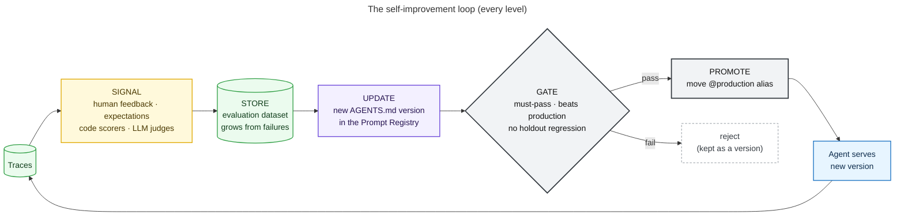

# Build Your Own Self-Improving Agent with OpenClaw and MLflow

Companion repo for the ODSC West 2026 tutorial and the *Self-Improvement & MLflow* blog series.

An [OpenClaw](https://github.com/openclaw/openclaw) support agent for a fictional product, Acme Cloud, goes from
"a person reads traces and edits a prompt" to "the loop notices a problem, fixes it, proves the fix,
and ships it unattended". Along the way MLflow provides the traces, the signal, the store, and the gate.

<!-- diagram:01-loop -->

<!-- /diagram -->

Architecture diagrams for the system and each level are in [docs/architecture](docs/architecture/README.md), as
Mermaid, SVG, and PNG, in one visual style.

## The levels

Every level runs the same loop. Two things change: **who writes the candidate** and **who approves it**.

| Level | Folder | Who writes the change | Who promotes | MLflow pieces introduced |
|---|---|---|---|---|
| 0 | [`level0_instrument`](levels/level0_instrument/README.md) | – | – | Prompt Registry, tracing, `update_current_trace` tags |
| 1 | [`level1_signal`](levels/level1_signal/README.md) | – | – | `log_feedback` / `log_expectation`, label schemas + review queues, `@scorer`, `Guidelines`, `make_judge`, `evaluate()` on existing traces, **tool-level scorers on OpenClaw's own spans** |
| 2 | [`level2_manual_loop`](levels/level2_manual_loop/README.md) | a person | a person | evaluation datasets, side-by-side `evaluate()`, `@mlflow.test` regression suite, alias promotion |
| 3 | [`level3_agent_assisted`](levels/level3_agent_assisted/README.md) | MLflow issue discovery + an LLM analyst: an `AGENTS.md` edit **or a new OpenClaw skill** | a person (reviews a proposal) | `discover_issues`, scorer registry (theme judges grow with evidence), skills versioned in the Prompt Registry + OpenClaw Skill Workshop |
| 4 | [`level4_optimizer`](levels/level4_optimizer/README.md) | GEPA (`optimize_prompts`) | a person | judge alignment (`judge.align`, SIMBA / MemAlign), `optimize_prompts` |
| 5 | [`level5_autonomous`](levels/level5_autonomous/README.md) | GEPA, the analyst, a new skill, **or OpenClaw editing itself** | the gate | online scoring (`register().start()`), loop runs as MLflow runs, rollback receipts |

The update target throughout is the agent's `AGENTS.md`. OpenClaw's behavior is defined by plain files in its
workspace. We keep `AGENTS.md` in the MLflow Prompt Registry and render the chosen version into a fresh
workspace right before the agent runs (`src/sia/workspace.py`). Every change is then a numbered version with a
commit message, and every rollback is an alias move. The policy documents in `knowledge/` sit next to it in the
workspace and stay fixed.

### What gets updated

Two things can change, and both are versioned in the MLflow Prompt Registry:

| Update target | Where it lives | When to use it | Shipped by |
|---|---|---|---|
| **`AGENTS.md`** | `acme-support-agents-md` | behavior for every answer: lead with the answer, treat `knowledge/` as the source of truth, never guess | moving `@production` |
| **a skill** (`skills/<name>/SKILL.md`) | `acme-skill-<name>`, one prompt per skill | a procedure for one kind of question (e.g. escalations); the agent sees only its name and description until a question matches | OpenClaw Skill Workshop `apply`, *then* moving `@production` |

An agent version is an `AgentSpec`: one `AGENTS.md` version plus a set of skill versions, such as
`v2+handle-support-process@1`. The gate compares two specs, and `promote()` returns a receipt that `rollback()` can
undo exactly. This is the next step up the update-target scale from Part 1 (prompt → memory → skill → code).

## Quickstart

The tutorial runs on Claude by default:
* **Claude Haiku 5.5** answers as the support agent. A small agent keeps the seeded failures visible.
* **Claude Opus 5.5** judges, analyzes failures, and drives the optimizer.

Prefer to stay offline? Set `SIA_PROVIDER=ollama` (see [Running locally on Ollama](#running-locally-on-ollama-what-to-expect)).

```bash
git clone <this repo> && cd self-improving-agent
make install                      # uv venv + pip install -e ".[dev]"
cp .env.example .env              # SIA_PROVIDER=anthropic; put your ANTHROPIC_API_KEY in .env
make server                       # MLflow on http://127.0.0.1:5000 (leave running)
```

In a second terminal:

```bash
make level0 level1 level2         # instrument, collect signal, first manual loop
make drift level3                 # new kind of traffic; analyst writes proposals/<ts>/
python levels/level3_agent_assisted/02_accept.py proposals/<ts> --promote
make level4                       # align the judge, run GEPA, gate
make reset setup level5           # start over and let the loop do all of it by itself
```

**Prefer to read code first?** The [walkthrough notebooks](notebooks/README.md) (`make notebooks`) go through the
same pieces step by step, with OpenClaw, Hermes Agent, and MLflow side by side. They run offline by default.

**Want MLflow on top of the agents' own Python APIs?** The [SDK notebooks](notebooks/sdk/README.md)
(`make sdk-notebooks`) drive OpenClaw through its gateway with the `openclaw-sdk` client, and Hermes Agent
in-process through `AIAgent`. Over five notebooks they build up, in the notebook cells:
* MLflow tracing, with token usage and cost per model turn;
* the Prompt Registry as the source of `AGENTS.md`;
* `mlflow.genai.evaluate` with Claude judges;
* human feedback;
* a gated improvement loop.

**No API key or OpenClaw yet?** `make rehearse` runs every level with a rule-based stand-in agent and code-only
scorers in a throwaway store. It takes about three minutes. It's how CI checks the loop mechanics, and it's a
dry run for the workshop.

### Choosing an LLM provider

Every model is named in MLflow's URI format, `<provider>:/<model>`. MLflow's judges, GEPA and judge alignment
take these URIs directly. The repo's own model calls (the `direct` runtime and the trace analyst) go through
[LiteLLM](https://docs.litellm.ai/), so any provider it supports works. For the most common ones, one variable
picks a preset (`src/sia/llm.py`):

| `SIA_PROVIDER` | agent model | judge / analyst / optimizer | key | judge alignment |
|---|---|---|---|---|
| `anthropic` (default) | `claude-haiku-5-5` | `claude-opus-5-5` | `ANTHROPIC_API_KEY` | SIMBA |
| `ollama` | `gemma4:e4b` | `gemma4:e4b` | none (runs locally) | SIMBA |
| `openai` | `gpt-5.4-mini` | `gpt-5.5` | `OPENAI_API_KEY` | MemAlign |
| `gemini` | `gemini-3.5-flash` | `gemini-3.1-pro-preview` | `GEMINI_API_KEY` | MemAlign |
| `mistral` | `mistral-small-latest` | `mistral-large-latest` | `MISTRAL_API_KEY` | MemAlign |
| `groq` | `llama-3.1-8b-instant` | `llama-3.3-70b-versatile` | `GROQ_API_KEY` | SIMBA |

To override either model, or to mix providers (for example, a local agent graded by a hosted judge):

```bash
SIA_AGENT_MODEL=ollama:/gemma4:e4b
MLFLOW_GENAI_JUDGE_DEFAULT_MODEL=openai:/gpt-5.5
```

The OpenClaw runtime gets the same model, translated to OpenClaw's naming (`gemini:/…` → `google/…`).
OpenClaw reads the provider key from the environment. The judge model needs to handle tool calling and
long structured output reasonably well. A small local model may make a weak judge; the Level 1 agreement check
is where that would show up.

#### How Claude is called

Current Claude models reject several request shapes that other providers accept: forced tool choice, disabled
thinking, and non-default `temperature`. So the repo talks to Claude through the official Anthropic SDK wherever
it makes the call itself:
* **The trace analyst** (`sia.llm.claude_structured`) uses Opus 5.5 at `high` effort. It returns schema-checked
  JSON through structured outputs and has server-side refusal fallbacks enabled.
* **The `direct` runtime** (`sia.agent.run_direct_claude`) runs a manual tool-use loop with strict tool schemas,
  prompt caching on the stable `AGENTS.md` + tools prefix, and `SIA_AGENT_EFFORT` (default `low`).
* **Hermes** uses its native Anthropic provider.
* **OpenClaw** uses its own Anthropic provider.

MLflow's judges, GEPA, and judge alignment use their own Claude integrations and take the model URI as-is.

### Running locally on Ollama: what to expect

On a 16 GB MacBook with `gemma4:e4b`, measured while building this repo:

| Step | Time |
|---|---|
| first model load | ~45 s |
| one OpenClaw agent answer (reads `AGENTS.md` + a knowledge file) | ~30–100 s |
| one LLM-judge verdict | ~30 s |
| Level 3 trace analyst (one proposal) | ~3–4 min |

Some practical notes:
* **One model plays every role.** That keeps memory use to one model. A model judging its own answers is a
  known bias, so look at the Level 1 judge-vs-human agreement check before trusting it. If you have the RAM,
  point the judge at something bigger (`MLFLOW_GENAI_JUDGE_DEFAULT_MODEL=ollama:/gpt-oss:20b`), or at a hosted
  model.
* **Context window.** Ollama's default context is small. Every call asks for `SIA_OLLAMA_NUM_CTX` (32768) tokens,
  and the OpenClaw profile is limited to the `read` tool so its system prompt stays small.
* **Budgets are scaled down.** GEPA defaults to 16 metric calls on Ollama (60 on hosted providers;
  `SIA_GEPA_BUDGET` overrides). For a faster workshop run, use `--repeat 1` in Level 0 and `--simulate 8` in Level 5.
* **Rehearse first.** `make rehearse` runs every level in a few minutes with no model at all.

### Agent runtimes (`SIA_BACKEND`)

| Backend | What runs | Use for |
|---|---|---|
| `openclaw` (default) | `openclaw agent --local --json` against an **isolated** profile in `.openclaw-state/`. Your `~/.openclaw` is never touched. | the real demo |
| `hermes` | [Hermes Agent](https://hermes-agent.nousresearch.com/) (Nous Research), in-process, against the same workspace, with an **isolated** home per agent version in `.hermes-state/`. Your `~/.hermes` is never touched. | the same demo on a second agent framework |
| `direct` | a small tool-use loop (any provider, via LiteLLM) over the same workspace files (`list_files`, `read_file`) | GEPA and CI, where the agent is called dozens of times |
| `offline` | a deterministic simulator that follows a few instructions in `AGENTS.md` | rehearsals and tests without keys |

#### Running on Hermes Agent

```bash
make hermes                       # pip install -e ".[hermes]" + builds the 64K-context Ollama model
SIA_BACKEND=hermes make level0 level1 level2
```

Every level works the same way: the improvement loop only sees MLflow traces and an `AgentSpec`. Hermes loads
`AGENTS.md` from the workspace as project context, reads `knowledge/` with its `read_file` tool, and gets the
spec's skills in its own Hermes home, where it loads them with `skill_view`. Each answer is one trace:

```
acme_support_agent (AGENT) -> hermes.agent (CHAIN) -> llm_call (CHAT_MODEL) · read_file / skill_view (TOOL) · llm_call
```

So the tool-level scorers work unchanged. Hermes' own learning loop stays on, but with `write_approval` set: any
skill or memory it decides to save is staged under `<home>/pending/` instead of being written into the agent.
(Gating that queue with MLflow is the next step.)

On a 16 GB MacBook with local `gemma4`, a Hermes answer takes about 1–3 minutes.

OpenClaw needs Node and `npm i -g openclaw`. `make setup` writes the isolated config and validates it. Optional:
`python levels/level0_instrument/01_setup.py --mlflow-otel` also streams OpenClaw's internal spans (model and
tool calls) to MLflow's OTLP endpoint via the `diagnostics-otel` plugin. The MLflow team also publishes an
OpenClaw tracing plugin (`openclaw plugins install @mlflow/mlflow-openclaw`, release candidate as of 0.2.0).

## Walkthrough

### Level 0: instrument
`01_setup.py` registers `scenario/workspace_v1/AGENTS.md` as v1 and points the `production` alias at it.
`02_first_traces.py` sends a week of questions. Each one becomes a trace tagged with `topic`, `backend`,
`prompt_version`, and `source=production`. Evaluation and optimizer traffic is tagged `source=eval`, so it can
never be mistaken for real signal. v1 has three seeded problems: stale facts (30-day refunds), a mandatory
Terms-of-Service disclaimer, and "give your best guess".

### Level 1: signal
* `01_human_feedback.py` has three simulated reviewers label every trace: `quality` feedback, an
  `expected_response`, and a `key_facts` answer key. They grade with slightly different rubrics on purpose,
  because that is what real reviewer pools do. `--live` creates a label schema and review queue so people can
  label in the MLflow UI instead.
* `02_automated_signal.py` runs code scorers and LLM judges on the existing traces (`evaluate()` with no
  `predict_fn`) and prints failure rate by topic.
* `03_signal_quality.py` checks the verifiers before trusting them: judge-vs-human agreement, reviewer
  strictness, and failure themes. *An optimizer is only as good as its verifier.*
* **Tool-level signal.** After every OpenClaw answer, the harness exports OpenClaw's own session trajectory
  (`openclaw sessions export-trajectory`) and replays it inside the trace: one LLM span per model turn, and one TOOL
  span per tool call with its arguments and result (`src/sia/openclaw_trace.py`). Two code scorers then judge
  *how* the answer was found, not just what it says:
  * `read_right_policy` checks whether the agent read `knowledge/<topic>.md` for the question's topic. This is how
    "answered an SSO question from the billing policy" becomes a failing verdict.
  * `focused_reading` flags shotgun reading, where the agent opens every policy file every time.

  Set `SIA_TOOL_JUDGE=1` to also run MLflow's `ToolCallCorrectness` judge on the same spans.

### Level 2: the manual loop
Build the dataset from human-failed traces, register a hand-written fix
(`scenario/fixes/level2_manual_AGENTS.md`) as v2 without promoting it, then run the gate:

```
scorer                    train/baseline   train/candidate  holdout/baseline holdout/candidate
has_key_facts                         0%              100%                0%              100%
no_disclaimer_opener                  0%              100%                0%              100%
no_stale_policy                      64%              100%               83%              100%
```

The gate rules live in `src/sia/gate.py` and every later level reuses them:
1. must-pass scorers (`no_stale_policy`) are at 100%,
2. the candidate beats production on the dataset,
3. the candidate is not worse on the **holdout**, which no optimizer ever sees.

`make test` runs the same dataset as a pytest suite with `@mlflow.test`, and `.github/workflows/agent-regression.yml`
runs it on every PR.

### Level 3: agent-assisted
With ten reviewers and a week of traffic, the bottleneck is reading. `01_propose.py` hands that reading to two readers:

1. **MLflow issue discovery.** `discover_issues` clusters the failing traces into named issues with root causes
   and severities, and links each issue back to its traces in MLflow. It uses the verdicts already on the traces for
   triage, so it doesn't pay an LLM to re-judge them, and it sees each trace's tool calls. `--discovery analyst`
   skips it.
2. **An LLM analyst** turns those issues into judge criteria and **one** proposed change. It also picks the update
   target:
   * `AGENTS.md` for behavior that applies to every answer;
   * a **skill** for a procedure that only matters for one kind of question.

   `--target` forces either one.

Everything lands in `proposals/<ts>/` for review. `02_accept.py` registers each theme criterion as a Guidelines
judge in MLflow's scorer registry (`theme_<slug>`), so the test suite grows with the evidence, then registers the
candidate:
* **`AGENTS.md`:** a new prompt version, gated against production.
* **Skill:** filed with **OpenClaw's Skill Workshop**, which creates a pending, security-scanned proposal. The same
  `SKILL.md` is registered as an MLflow skill version, and the gate compares production with production-plus-the-skill.
  * **Gate passes and you run `--promote`:** Workshop `apply` runs first, which re-scans the skill and records rollback
    metadata. Then the skill's `@production` alias moves.
  * **Gate fails:** the Workshop proposal is `reject`ed with the gate's reasons attached.

  MLflow decides *whether* a skill ships; OpenClaw governs *how* it's written into the workspace.

Prefer Claude Code? `mlflow agent setup --agent claude` installs MLflow's trace-analysis skills; give it the same job.

### Level 4: optimizer
* `01_align_judge.py` aligns the `quality` judge to the reviewers' labels (`judge.align`). It uses SIMBA
  when the provider has no embedding model (Anthropic, Groq, Ollama), and MemAlign otherwise. Agreement is measured on held-out labels, and the
  aligned judge is registered only if it helped.
* `02_optimize.py` runs `mlflow.genai.optimize_prompts` with `GepaPromptOptimizer`. Its scorers are the code
  checks, the guideline and theme judges, and the aligned judge. Run it with `SIA_BACKEND=direct`.
* `03_gate.py` shows the diff and runs the gate. Read the diff: optimizers can win by pleasing the judge.

### Level 5: autonomous
`02_run_loop.py` runs `sia.loop.cycle()`. Each cycle is one MLflow run:

1. **Signal:** read the production traces that arrived since the last cycle, and score any that are unscored.
2. **Verifier health:** if the judge's agreement with new human labels drops below 75%, re-align it, or **halt and ask for a person**.
3. **Store:** add human-labeled failures to the dataset. Failures only a scorer caught wait for a human label.
4. **Update:** `--improver gepa | analyst | skill | openclaw`.
   * `skill` answers each failure cluster with an OpenClaw skill, filed through the Skill Workshop; `analyst` picks a
     skill or an `AGENTS.md` edit itself.
   * `--discover` finds the themes with MLflow issue discovery first.
   * With `openclaw`, `openclaw agent exec` edits a copy of its own workspace, driven by the failure report.
5. **Gate:** the same rules as Level 2, plus a bloat guard.
6. **Ship:** move the alias, and record the failure rate it replaced. A later cycle rolls back if live results are worse.

```
======== cycle 1 ========   production v1: failure rate 62%  → proposed v2 → gate 35%→100% → PROMOTED
======== cycle 2 ========   drift traffic starts (new support_process policy)   → healthy (6%)
======== cycle 3 ========   production v2: failure rate 19%  → proposed v3 → gate 93%→100% → PROMOTED
======== cycle 4 ========   production v3: failure rate 0%   → healthy
```

`01_monitor.py` turns on server-side online scoring, so judges label production traffic as it arrives. It needs
`mlflow server` with a database backend. Custom `@scorer` code can't be registered on OSS MLflow, so the loop runs
the code checks itself.

Humans stay in the loop where they can't be replaced: labeling a sample of traffic. Those labels are the ground
truth that keeps the judge honest and the dataset growing.

## Repository layout

```
scenario/            knowledge base, flawed v1 AGENTS.md, the Level 2 fix, cases.yaml (traffic / holdout / drift)
src/sia/
  agent.py           traced entry point + openclaw / direct / offline runtimes; AgentSpec (AGENTS.md + skills)
  openclaw_trace.py  OpenClaw session trajectory -> LLM + TOOL spans inside each trace
  openclaw_client.py OpenClaw from Python: isolated gateway, openclaw-sdk client (protocol v4), MLflow tracer
  hermes_runtime.py  Hermes Agent runtime: per-version Hermes home, LLM + TOOL spans, Ollama 64K setup
  skills.py          skills as an update target: MLflow skill versions + OpenClaw Skill Workshop
  signals.py         code + tool-level scorers, Guidelines judges, the alignable "quality" judge, theme judges
  data.py            labeled traces -> evaluation dataset; holdout rows
  gate.py            scorecards, promotion rules, promote / rollback
  improvers.py       failure report, MLflow issue discovery, LLM analyst, OpenClaw self-edit, alignment, GEPA
  loop.py            one autonomous cycle
  reviewers.py       simulated reviewers (with deliberate disagreement)
  traffic.py         simulated production traffic + labeling
levels/              one folder per level; each script's docstring explains the step
tests/unit           offline smoke tests (CI, no keys)
tests/agent          the regression gate (@mlflow.test over the dataset + holdout)
```

## Notes on MLflow 3.16.1

We hit three issues while building this. The workarounds are in the code:
* `EvaluationResult.passed` treats expectation columns (such as `expected_response/value`) as assertions, so
  `assert result.passed` fails on any dataset row that has an expected response. `sia.gate.scorer_failures()`
  checks only the scorers' own columns.
* Usage telemetry can deadlock on a lazy import when `evaluate()` runs scorers in worker threads. `import sia`
  sets `MLFLOW_DISABLE_TELEMETRY=true`.
* Registering the MLflow pytest plugin in a root `conftest.py` hung subprocess-based tests. The agent suite
  enables it with `pytest -p mlflow.pytest.plugin tests/agent`.

Boolean feedback is stored as text. Filter with `feedback.quality = 'false'`, not `= False`.

`discover_issues` is importable from `mlflow.genai.discovery.pipeline` in 3.16.1. It isn't re-exported from
`mlflow.genai`.

## Notes on Hermes Agent 0.19.0

* **One venv is enough.** `hermes-agent` installs alongside `mlflow[genai]` 3.16.1, LiteLLM, GEPA, and DSPy.
  `from run_agent import AIAgent` works from a plain pip install.
* **Hermes needs a 64K context window for tool use, and Ollama's `/v1` endpoint ignores the requested size.**
  Hermes refuses to run with less than 64K tokens of context. It asks Ollama for the full window per request, but
  it does so through Ollama's OpenAI-compatible endpoint, which silently ignores that setting. The model then
  runs with Ollama's 4K default and answers get cut off mid-sentence.
  * The fix is a local alias with the window built in: `gemma4:e4b` → `gemma4-e4b-64k`. It's metadata only and
    shares the base model's weights. `make hermes` creates it, and `ollama rm gemma4-e4b-64k` removes it.
* **MLflow's OpenAI autolog doesn't nest Hermes' model calls.** It sees them, but Hermes runs them on a worker
  thread, so each one becomes its own disconnected trace.
  * `sia.hermes_runtime` wraps Hermes' two model-call methods in LLM spans instead, and turns its
    `tool_start` / `tool_complete` callbacks into TOOL spans.
  * Those methods are private, so the extra pins `hermes-agent==0.19.0`.
* **Runs are serialized.** Hermes reads `AGENTS.md` from the current working directory, which is shared by every
  thread in the process, so the runtime runs one Hermes answer at a time.
* **Per-version isolation.** Each version uses Hermes' context-local home override (`set_hermes_home_override`),
  which needs no environment-variable changes.
* **Approve and reject from Python.** Pending skill and memory writes can be applied or dropped through
  `tools.write_approval`, `tools.skill_manager_tool.apply_skill_pending`, and
  `tools.memory_tool.apply_memory_pending`. There's no CLI command for this; the `/skills approve` slash commands
  are interactive only.
* **Tracing plugin not used.** MLflow documents the community `hermes-otel` plugin for interactive use (one OTLP
  trace per turn). The in-process runtime doesn't need it.
* **Providers.** Claude uses Hermes' native Anthropic provider (the Anthropic SDK). Ollama and other hosted
  providers go through Hermes' `custom` provider and each provider's OpenAI-compatible endpoint
  (`sia.llm.hermes_endpoint`).

## Notes on OpenClaw 2026.9.1

* **openclaw-sdk.** The `openclaw-sdk` 2.1.0 Python client speaks gateway protocol v3. OpenClaw 2026.9 gateways
  speak v4. `sia.openclaw_client` adapts only the handshake: protocol 4, signing the challenge timestamp, the
  `tool-events` capability, and an explicit token and device key. It runs its own gateway on port 19556, so it
  never connects to yours. See [notebooks/sdk](notebooks/sdk/README.md).
* **Workspace override.** OpenClaw takes its workspace from config (`agents.defaults.workspace`) and ignores
  `OPENCLAW_WORKSPACE_DIR` once that key is set. The harness writes a small per-workspace config for each agent
  version (`sia.agent.openclaw_env`).
* **Headless Skill Workshop.** The Skill Workshop CLI (`openclaw skills workshop propose-create | propose-update |
  apply | reject`) works without a running gateway.
* **MLflow's OpenClaw plugin.** `@mlflow/mlflow-openclaw` 0.2.0-rc.0 produces the same LLM/TOOL span tree, but it
  doesn't work here as published:
  * it ships TypeScript only, which OpenClaw refuses for npm installs;
  * it imports `openclaw/plugin-sdk/diagnostics-otel`, which this version no longer has (the API moved to
    `openclaw/plugin-sdk/diagnostic-runtime`);
  * it flushes traces asynchronously after the run, which `agent --local` exits before.

  Trajectory replay gives the same spans without a plugin. If you run OpenClaw as a long-lived gateway, the plugin
  becomes an option once a compatible release ships.
