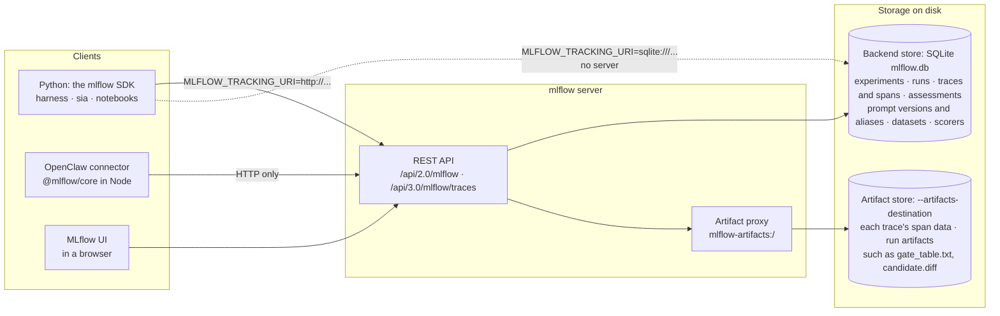
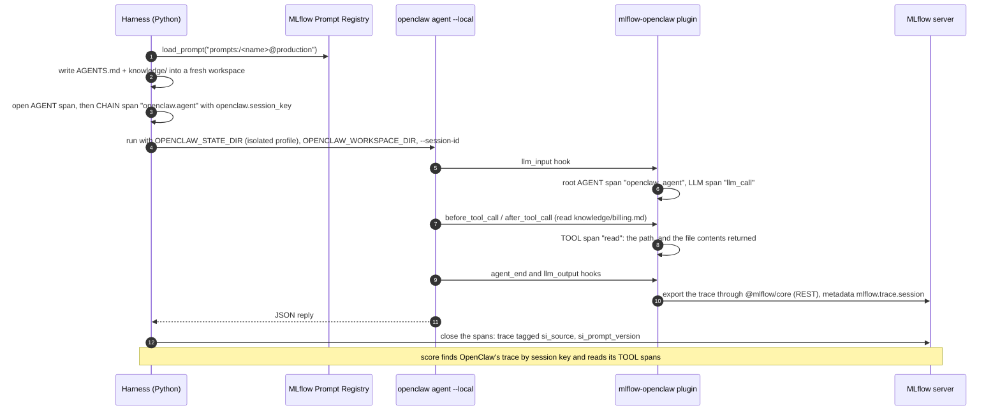
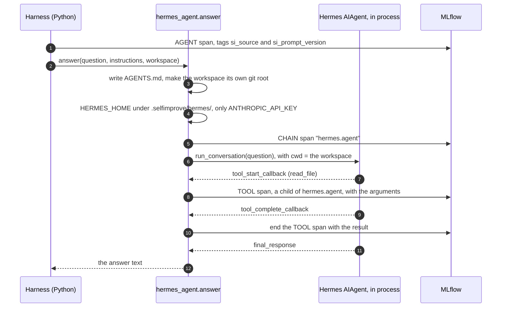

# Architecture: MLflow, the MLflow server, OpenClaw and Hermes

How the pieces underneath the repo fit together: where MLflow keeps everything, what an MLflow server
adds, and how one OpenClaw or Hermes answer turns into a trace. For each component's own diagram, see
[`harness/README.md`](../harness/README.md#architecture) and [`sia/README.md`](../sia/README.md#architecture).

## MLflow and the MLflow server

Everything the loop decides is stored in MLflow: traces and the verdicts on them, every version of the
instructions, the evaluation dataset, the judges, and one run per job. Python code can write to a SQLite
file directly. An MLflow **server** puts an HTTP API in front of the same storage, and that's required
as soon as a non-Python client (the OpenClaw connector) or several processes need to share it.

| MLflow object | What the repo keeps in it |
|---|---|
| Trace, with spans | one agent answer: the `AGENT` root, `LLM` and `TOOL` spans, tags such as `si_source` and `si_prompt_version`, metadata such as `mlflow.trace.session` |
| Assessment | a verdict on a trace: `quality` feedback or an `expected_response` expectation, with its source (`HUMAN`, `CODE`, `LLM_JUDGE`) |
| Prompt version and alias | each version of `AGENTS.md`, with tags (`author`, `gate`, `promoted_by`, ...); `@production` is what the agent runs |
| Evaluation dataset | the tests: inputs, expectations, and provenance tags, including the `split` that hides the holdout |
| Registered scorer | an aligned `quality` judge, or a `theme_*` judge written from failures |
| Run | one job (`si.job`), or an evaluation inside the gate, with metrics, tags and artifacts |

The servers in this repo:

| Server | Command | Port | Store |
|---|---|---|---|
| SIA | `cd sia && make server` | 5000 | `sia/mlflow.db` |
| Harness, default | none: Python writes the file directly | | `harness/.selfimprove/mlflow.db` |
| Harness, browsing that file | `cd harness && make ui` | 5003 | the same file, read through a UI server |
| Harness with the OpenClaw connector | an `mlflow server` you start, set in `MLFLOW_TRACKING_URI` | your choice | your choice |
| The talk's precomputed demo | `cd harness && make session-server` | 19560 | `harness/session/store/` |
| The runbook's live connector demo | the runbook's `mlflow server` command | 5050 | `$HOME/odsc-live/` |

A store written through a server with `--artifacts-destination` records artifact locations as
`mlflow-artifacts:/` URIs, so read it back through a server, not as a `sqlite:///` file.

## One OpenClaw answer, traced

OpenClaw runs as its own process, so the harness can only see what goes in and what comes out. The
MLflow connector, a plugin inside OpenClaw, writes a **second trace** with what happened in between,
and the two traces share a session key.

What it takes:

* the connector installed in the profile OpenClaw runs with, with
  `plugins.entries.mlflow-openclaw.hooks.allowConversationAccess=true` (OpenClaw 2026.10 drops the
  `llm_input`, `llm_output` and `agent_end` hooks otherwise, and nothing is exported);
* an MLflow **server**, because the plugin exports over HTTP;
* in the harness, `SI_AGENT=openclaw` and `SI_OPENCLAW_MLFLOW=1`, which installs the connector into
  the isolated profile.

The plugin records one `llm_call` span per run (OpenClaw reports the run's model calls together), a
`TOOL` span per tool call, token usage, model, session and user. It doesn't record cost.
[`connectors/openclaw-mlflow`](../connectors/openclaw-mlflow/README.md) has the details.

## One Hermes answer, traced

Hermes Agent runs **inside** the harness's Python process, through `harness/examples/hermes_agent.py`.
Its tool callbacks become spans in the harness's own trace, so there is one trace and no plugin.

| | OpenClaw | Hermes |
|---|---|---|
| Runs | as a separate process (`openclaw agent --local`) | in the harness's process (`AIAgent`) |
| Traced by | the MLflow connector plugin, as a second trace | the adapter's callbacks, in the harness's trace |
| Linked by | session key: `openclaw.session_key` = `mlflow.trace.session` | being the same trace |
| Spans | `openclaw_agent` (AGENT), `llm_call` (LLM), a TOOL per tool call | `hermes.agent` (CHAIN), a TOOL per tool call; this adapter records no model-call span |
| Needs a server | yes: the connector exports over HTTP | no: works with the SQLite default |
| Isolated from | `~/.openclaw` and gateway 18789, via `OPENCLAW_STATE_DIR` | `~/.hermes`, via `HERMES_HOME`; Claude Code's saved login, via the API key only |

A Hermes MLflow plugin that traces Hermes on its own (outside the harness) exists on the
`mlflow-personal-agent-connector` branch (`connectors/hermes-mlflow`), not on this one.
