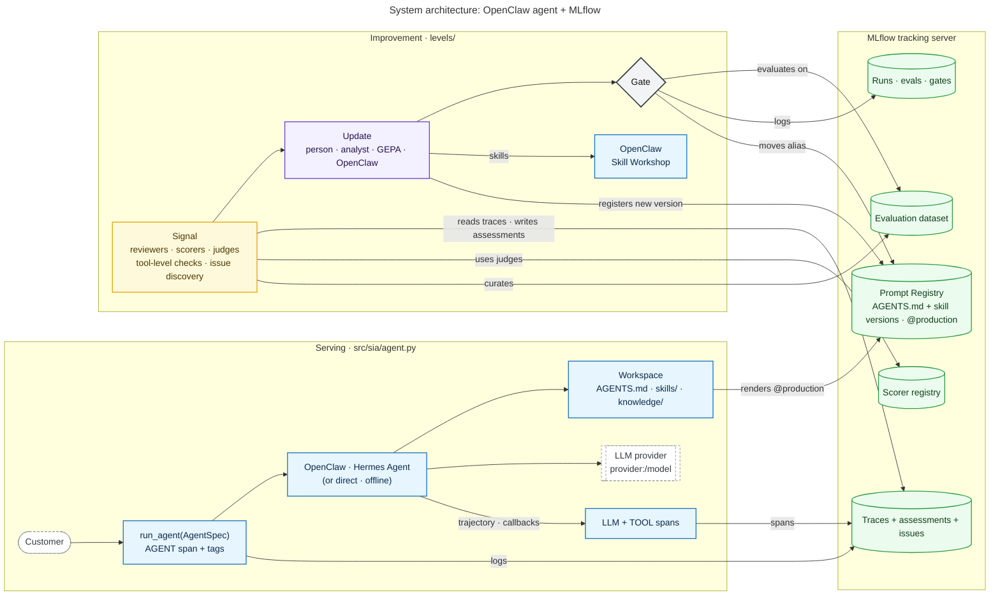
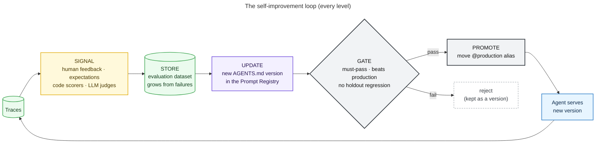
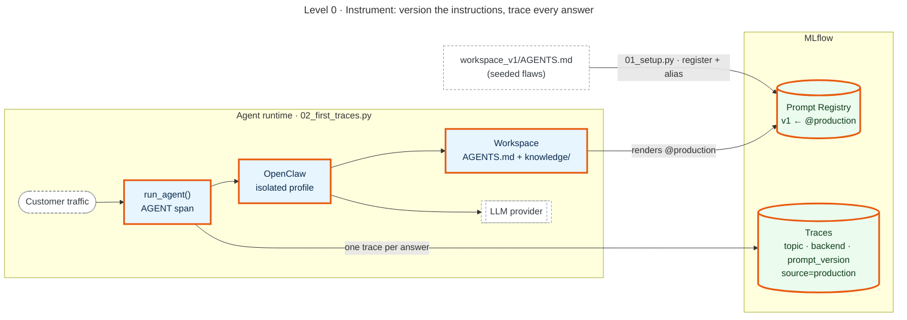
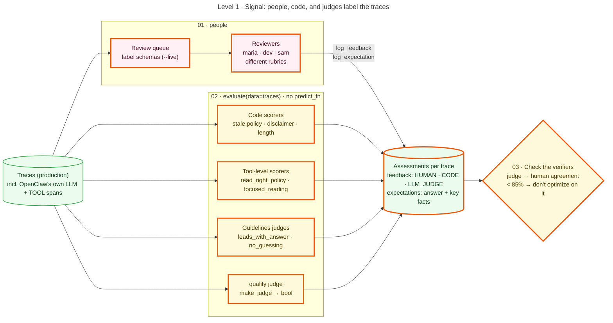
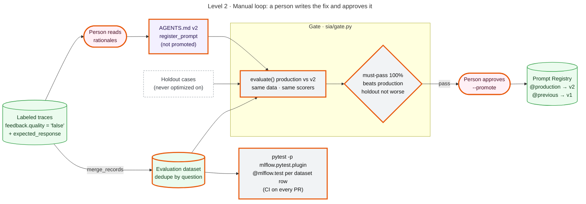
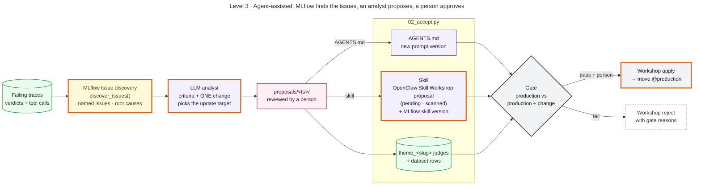
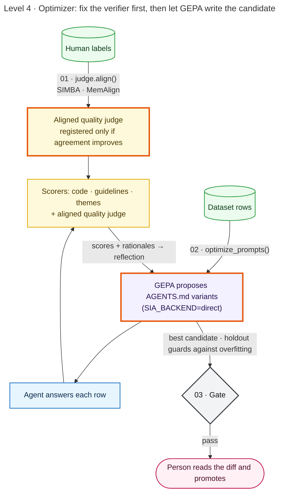
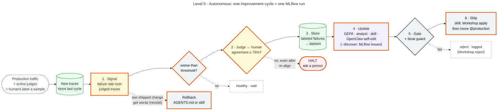

# Architecture diagrams

One diagram per level, plus three overview diagrams. The diagrams share one visual language, so they work as a
slide build-up:

| Color | Role |
|---|---|
| blue | agent runtime (harness, OpenClaw, workspace) |
| green | stored in MLflow (Prompt Registry, traces, datasets, scorer registry, runs) |
| yellow | automated signal (code scorers, LLM judges) |
| pink | people |
| purple | produces a candidate change |
| grey | the gate: decides and promotes |
| **orange outline** | **introduced at this level** |

| File | Use |
|---|---|
| `src/*.mmd` | the source; edit these |
| `mmd/*.mmd` | standalone Mermaid with styles inlined. Paste into [mermaid.live](https://mermaid.live), Notion, Confluence, or Slidev |
| `svg/*.svg` | vector, for slides and the web |
| `png/*.png` | 2x raster, for tools that want images |

After editing a source file, rebuild everything and refresh the copies embedded in the READMEs:

```bash
make diagrams
```

`make diagrams` needs Node.js and uses a local Chrome if one is installed. `python scripts/render_diagrams.py --no-images`
refreshes only the `.mmd` files and the markdown.

## System

<!-- diagram:00-system -->

<!-- /diagram -->

## The loop every level runs

<!-- diagram:01-loop -->

<!-- /diagram -->

## The levels

```mermaid
---
title: "Levels of self-improvement: who writes the change, who approves it"
---
flowchart LR
classDef runtime fill:#E7F5FF,stroke:#1971C2,color:#0B2A4A,stroke-width:1.5px
classDef mlflow fill:#EBFBEE,stroke:#2F9E44,color:#0F3D1A,stroke-width:1.5px
classDef signal fill:#FFF9DB,stroke:#E0A800,color:#4A3800,stroke-width:1.5px
classDef human fill:#FFF0F6,stroke:#C2255C,color:#4A0E24,stroke-width:1.5px
classDef update fill:#F3F0FF,stroke:#6741D9,color:#24124F,stroke-width:1.5px
classDef gate fill:#F1F3F5,stroke:#343A40,color:#111111,stroke-width:2px
classDef ext fill:#FFFFFF,stroke:#868E96,color:#343A40,stroke-width:1px,stroke-dasharray:4 3
classDef runtime_new fill:#E7F5FF,stroke:#E8590C,color:#0B2A4A,stroke-width:3px
classDef mlflow_new fill:#EBFBEE,stroke:#E8590C,color:#0F3D1A,stroke-width:3px
classDef signal_new fill:#FFF9DB,stroke:#E8590C,color:#4A3800,stroke-width:3px
classDef human_new fill:#FFF0F6,stroke:#E8590C,color:#4A0E24,stroke-width:3px
classDef update_new fill:#F3F0FF,stroke:#E8590C,color:#24124F,stroke-width:3px
classDef gate_new fill:#F1F3F5,stroke:#E8590C,color:#111111,stroke-width:3px
    L0["<b>Level 0 · Instrument</b><br/>version AGENTS.md<br/>trace every answer"]:::runtime
    L1["<b>Level 1 · Signal</b><br/>reviewers · code scorers · judges<br/>check the verifiers"]:::signal
    L2["<b>Level 2 · Manual loop</b><br/>writes: person<br/>approves: person"]:::human
    L3["<b>Level 3 · Agent-assisted</b><br/>writes: LLM analyst<br/>approves: person"]:::update
    L4["<b>Level 4 · Optimizer</b><br/>writes: GEPA + aligned judge<br/>approves: person"]:::update
    L5["<b>Level 5 · Autonomous</b><br/>writes: GEPA · analyst · OpenClaw itself<br/>approves: the gate"]:::gate
    L0 --> L1 --> L2 --> L3 --> L4 --> L5
```

<!-- diagram:02-levels-overview -->

<!-- /diagram -->

## Level 0 · Instrument
<!-- diagram:level0-instrument -->

<!-- /diagram -->

## Level 1 · Signal
<!-- diagram:level1-signal -->

<!-- /diagram -->

## Level 2 · Manual loop
<!-- diagram:level2-manual-loop -->

<!-- /diagram -->

## Level 3 · Agent-assisted
<!-- diagram:level3-agent-assisted -->

<!-- /diagram -->

## Level 4 · Optimizer
<!-- diagram:level4-optimizer -->

<!-- /diagram -->

## Level 5 · Autonomous
<!-- diagram:level5-autonomous -->

<!-- /diagram -->
