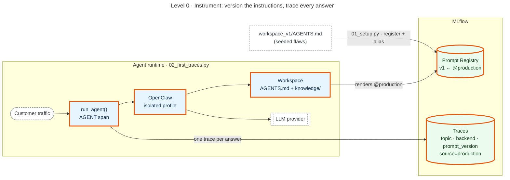

# Level 0 · Instrument

Version the thing you'll change, and trace everything the agent does. Nothing is judged yet.

| Script | Does |
|---|---|
| `01_setup.py` | registers `AGENTS.md` v1 in the Prompt Registry, points `@production` at it, writes the isolated OpenClaw profile |
| `02_first_traces.py` | sends a week of questions; one trace per answer, tagged `topic`, `prompt_version`, `source=production` |

**Look at:** MLflow UI → Experiments → acme-support-agent → Traces. Also Prompts → acme-support-agents-md.

**Runtimes:** the same scripts drive OpenClaw (default) or Hermes Agent (`SIA_BACKEND=hermes`, after `make hermes`). Both produce one trace per answer with LLM and TOOL spans; see the main README.

Mermaid source

<!-- diagram:level0-instrument -->

<!-- /diagram -->

