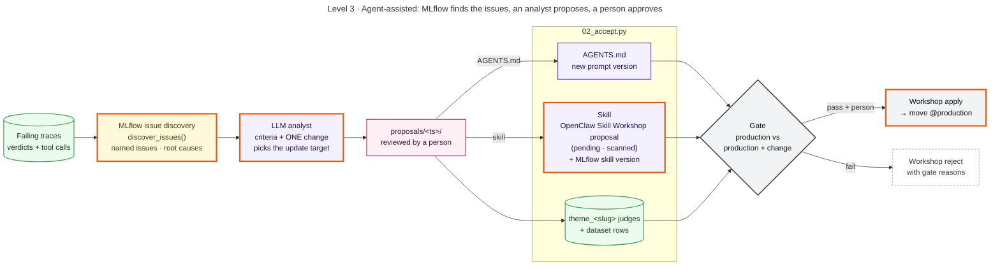

# Level 3 · Agent-assisted

MLflow finds the issues and an LLM analyst writes one change for a person to review. The change is either an
`AGENTS.md` edit or a **new OpenClaw skill** filed through the Skill Workshop. Accepted criteria become
registered judges, so the verifier set grows with the evidence.

| Script | Does |
|---|---|
| `01_propose.py` | MLflow `discover_issues` → LLM analyst → `proposals/<ts>/` (`--discovery analyst` skips MLflow; `--target agents_md / skill` forces the update target) |
| `02_accept.py <dir>` | registers the candidate (AGENTS.md version, or Workshop proposal + MLflow skill version) and the `theme_<slug>` judges, grows the dataset, runs the gate. `--promote` ships: for a skill, Workshop `apply` first, then the `@production` alias. A failing skill is Workshop-`reject`ed with the gate's reasons |

**Look at:** the issue-discovery run in MLflow and the issue assessments on the affected traces. In the isolated
OpenClaw profile, `openclaw skills workshop list` shows the proposal's status (pending, applied, or rejected).

Mermaid source

<!-- diagram:level3-agent-assisted -->

<!-- /diagram -->

