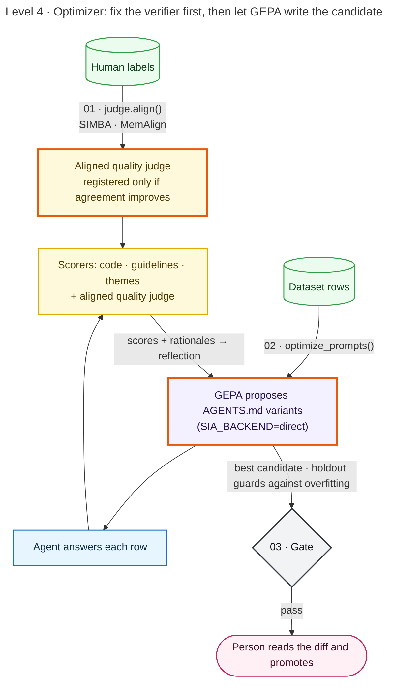

# Level 4 · Optimizer

Fix the verifier first: align the judge to the reviewers. Then let GEPA search for a better `AGENTS.md`, scored by that judge. The holdout set in the gate catches overfitting.

| Script | Does |
|---|---|
| `01_align_judge.py` | `judge.align()` (SIMBA, or MemAlign when embeddings are available); registers the aligned judge only if agreement improves |
| `02_optimize.py` | `optimize_prompts()` + `GepaPromptOptimizer`; run with `SIA_BACKEND=direct` |
| `03_gate.py` | diff + gate; `--promote` to ship |

Mermaid source

<!-- diagram:level4-optimizer -->

<!-- /diagram -->

