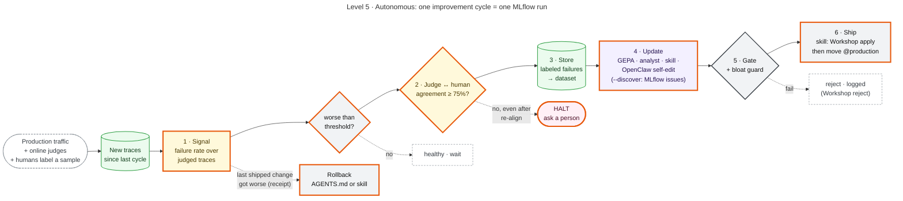

# Level 5 · Autonomous

The loop runs itself. Each cycle is one MLflow run: signal, verifier check, store, update, gate, ship, and rollback if the shipped version does worse. People label a sample of traffic and get called when the judge can't be trusted.

| Script | Does |
|---|---|
| `01_monitor.py` | server-side online scoring of production traces (`register().start()`) |
| `02_run_loop.py` | the cycle; `--improver gepa / analyst / skill / openclaw`, `--discover` for MLflow issue discovery, `--simulate N --drift` for the demo |

Mermaid source

<!-- diagram:level5-autonomous -->

<!-- /diagram -->

